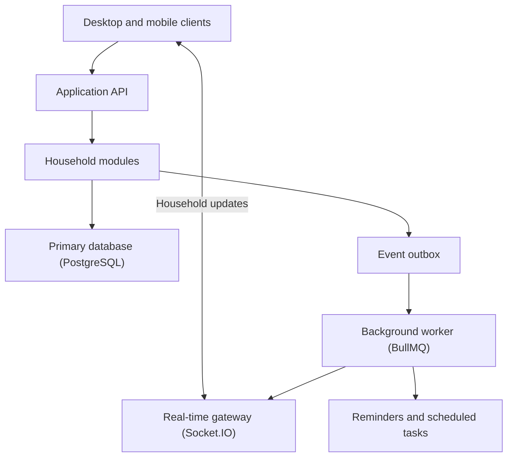
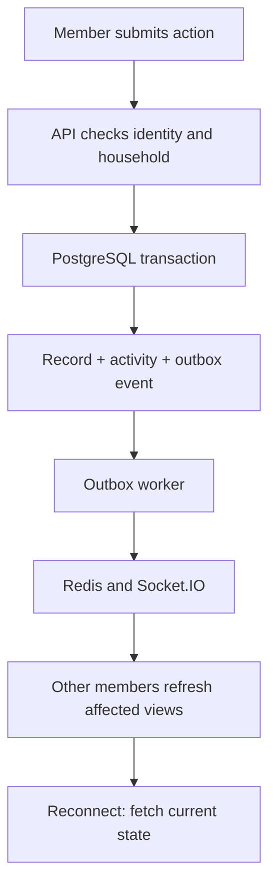
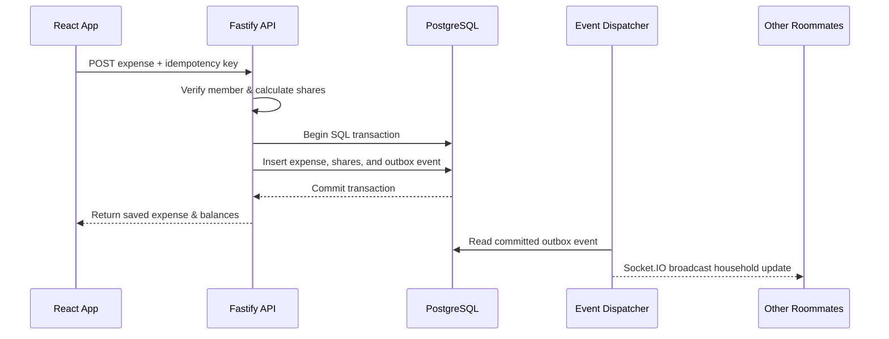
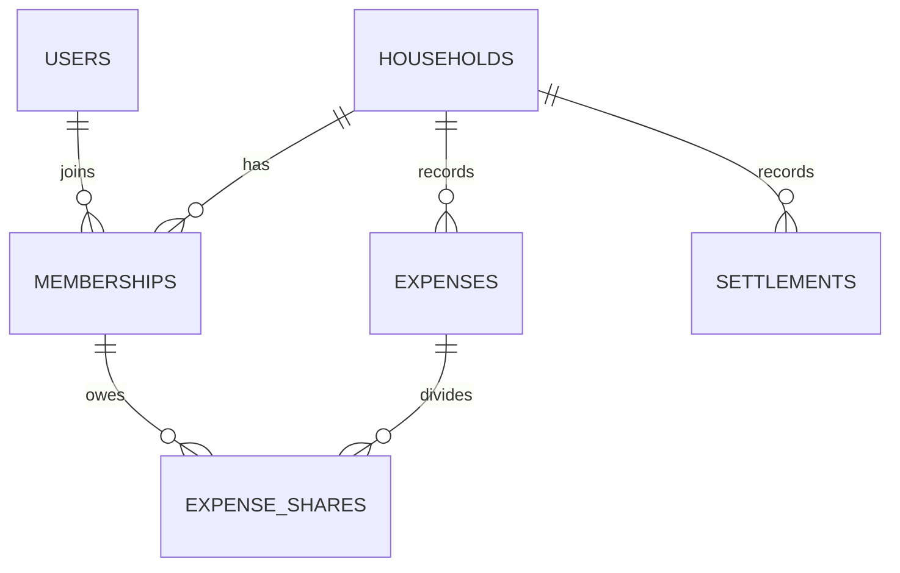

# RoomSync 🏠✨
> **One household. One shared workspace. Everything synchronized.**

RoomSync is a collaborative, real-time shared household workspace for roommates, bringing finances, shared shopping, chore rotations, recurring bills, and decision polls into a unified digital apartment.

Designed with the **Dreamhouse Arcade** visual identity (**Neo-Brutalism + Ethereal Pastel + Pixel Art**).

---

## 🎨 Dreamhouse Arcade Palette

| Color Name | Hex | Usage |
|---|---|---|
| **Cloud Lavender** | `#F5F0FF` | Primary Canvas Background |
| **Ink Plum** | `#30263E` | Outlines, High-Contrast Text, Hard Shadows |
| **Pixel Pink** | `#FF9FBF` | Primary Actions & CTAs, Active Nav Pills |
| **Arcade Lilac** | `#C5B2FF` | Secondary Surfaces, Segmented Filters |
| **Pixel Mint** | `#B6F0D2` | Completed States, Positive Balances |
| **Soft Glitch** | `#FFE88A` | Attention Highlights, Gold Coin Details |
| **Dream Sky** | `#A9E4F2` | Information Badges, Secondary Accents |
| **Apricot** | `#F3C5A7` | Warm Highlights & Gradients |

---

## 🏗️ Architecture & Technology Stack

- **Monorepo**: npm workspaces
  - `apps/web`: Next.js 15 (App Router, JavaScript/JSX, TanStack Query, Socket.IO Client, CSS Tokens)
  - `apps/api`: Fastify, node-postgres (`pg`), Socket.IO + Transactional Outbox Dispatcher
  - `apps/worker`: BullMQ, Redis, Background recurring tasks
  - `packages/shared`: Exact integer paise financial arithmetic, deterministic rounding, validation contracts
  - `supabase/`: Authoritative PostgreSQL schema migrations & seed data
- **Real-Time Engine**: Socket.IO + PostgreSQL transactional outbox.
- **Financial Guarantees**:
  - Currency: Indian Rupee (`₹`).
  - Stored strictly in **integer paise** (zero floating-point math).
  - Deterministic remainder allocation (sum of shares equals total expense exactly).
  - Authoritative balance calculation: $\text{net} = \text{paid} - \text{shares} + \text{sent} - \text{received}$. Sum across all roommates always totals ₹0.
  - Greedy debt simplification for minimal settlement transactions.

---

## 📊 System Architecture Diagrams

### 1. Dual-Channel Client & Gateway Architecture


### 2. Transactional Outbox & Event Lifecycle


### 3. Expense Creation & Settlement Sequence


### 4. Database Entity Relationships


---

## 🚀 Quick Start

### 1. Install Dependencies
```bash
npm install
```

### 2. Run Test Suite
```bash
npm test
```
Runs:
- `tests/financial/finance.test.js`: Exact conversions, equal/custom/percentage/weighted splits, balance invariants.
- `tests/integration/api.test.js`: All 13 REST API routes across finances, shopping, chores, bills, polls.
- `tests/security/security.test.js`: Multi-tenant household isolation, unauthorized access blocks, idempotency keys.

### 3. Run Development Servers
```bash
npm run dev
```
Starts:
- **Fastify API & Socket.IO**: http://localhost:4000
- **Next.js Web App**: http://localhost:3000

---

## 📁 Repository Structure

```text
RoomSync/
├── apps/
│   ├── web/                     # Next.js App Router (JS/JSX)
│   │   ├── app/                 # Layouts, globals.css, pages
│   │   ├── components/          # Sidebar, PixelIcons, View screens
│   │   └── lib/                 # TanStack Query & Socket.IO client
│   ├── api/                     # Fastify REST & Real-Time Backend
│   │   ├── src/database/        # Repository & db connection pool
│   │   ├── src/middleware/      # Auth & Household Isolation
│   │   ├── src/modules/         # Expenses, Shopping, Chores, Bills, Polls
│   │   ├── src/realtime/        # Socket.IO rooms & authorization
│   │   └── src/outbox/          # Transactional Outbox Dispatcher
│   └── worker/                  # BullMQ background task worker
├── packages/
│   └── shared/                  # Domain constants, paise math, validators
├── supabase/
│   ├── migrations/              # Normalized relational PostgreSQL schema
│   └── seed.sql                 # 3-roommate demo data (Aman, Riya, You)
├── tests/
│   ├── financial/               # Exact paise & split invariant tests
│   ├── integration/             # Complete API vertical tests
│   └── security/                # Household multi-tenant isolation tests
├── docker-compose.yml           # PostgreSQL & Redis container config
├── package.json
└── README.md
```
